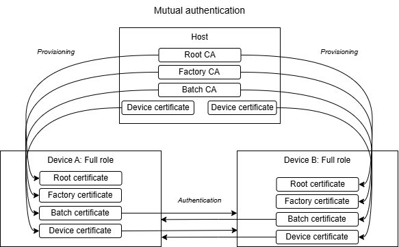
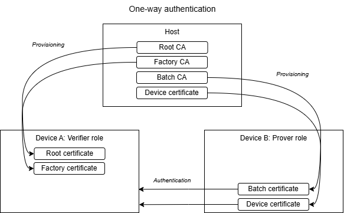
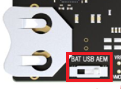

# SoC - Certificate-Based Authentication and Pairing

This example application demonstrates CBAP: certificate-based authentication followed by passkey pairing and bonding. The devices exchange the passkey through an encrypted application session that is protected by their device certificates. Between two devices running this example, no user interaction is required. With a mobile device, the user interacts with the mobile device only, see [Goals of CBAP](#goals-of-cbap). By default, the devices bond, and on subsequent connections the stored bond restores authenticated encryption without repeating CBAP. With bonding disabled, every connection runs CBAP.

> **Note: This example project is at EXPERIMENTAL quality level and is not meant to be used in production!**

## Goals of CBAP

CBAP establishes a bond that is authenticated by the device certificates. It does so with LE Secure Connections passkey entry pairing, using a passkey that the devices exchange over a security session established by the certificates. What CBAP achieves beyond this depends on the peer device:

- **Between two EFR devices**, the bond is established without user interaction. Neither device needs a display, a keyboard or a user: the passkey exchanged by CBAP takes the place of the user who would otherwise have to type it in.
- **Between an EFR device and a mobile device** (Android or iOS), the bond is established with user interaction on the mobile device only. The Bluetooth stack of a mobile device always reports the IO capability KeyboardDisplay, and an application can neither change it nor install a passkey of its own choice. Therefore, the mobile device is always the one that enters the passkey, and its user takes part in the pairing: depending on the platform, by typing in the passkey that the mobile application presents, or at least by confirming the pairing. The EFR device remains headless: it needs no display, no keyboard and no user.

In both cases, the IO capability that the EFR device reports to its Bluetooth stack describes the part it takes in passkey entry pairing, not its user interface. An EFR device that reports DisplayOnly displays the passkey to no one: it installs the passkey in its Bluetooth stack, and the peer device has received the passkey over the CBAP session. An EFR device that reports KeyboardOnly has no keyboard: it enters the passkey that it has received over the CBAP session. The reported IO capabilities serve only to make the Bluetooth stacks select passkey entry pairing, with the device that displays and the device that enters the passkey as CBAP requires.

## Provisioning

This example expects the device to be provisioned and prepared properly. This can be done with the **Bluetooth - SoC CBAP Dynamic Data Provisioning** application. Before proceeding, please read the readme of this application and complete the provisioning process.

- For prover devices, this includes an elliptic curve (EC) key pair, and the device and batch certificates signed properly.
- For verifier devices, the factory and root certificates are required.
- For the full role, everything is required that belongs to the prover role and to the verifier role.

## Configuration

From the CBAP perspective, these are the most important configurations:

- `CBAP Role` This determines the CBAP role. A device can be the verifier, prover, or both (full). Can be set in the *sl_bt_cbap_config.h* configuration header. (Otherwise, look for the CBAP component in the **Software Component** browser, and configure it using the GUI.)
- `Connection role` This determines the BLE connection role of the device. A device can be either the peripheral (server) or central (client). A peripheral device advertises itself, and presents its GATT table to the central, which scans and initiates the connection. Can be set in the *app_config.h* configuration header. (Or on the Overview tab, under Project Details, open the three-dots-menu, and click **Configuration**.)
- `Bonding` This determines whether the pairing creates a bond. Enabled by default: the bond is stored in the bonding database, and a bonded peer skips CBAP on reconnection. When disabled, the pairing creates no bond, its keys are discarded once the connection is closed, and every connection runs CBAP. The device then deletes all stored bonds at boot, so that a bond created while bonding was enabled does not skip CBAP either. Both devices have to use the same setting, because a device with bonding enabled refuses a pairing that does not create a bond. Can be set in the *sl_bt_cbap_config.h* configuration header.
- `Procedure timeout (ms)` This is the time a device has from opening a connection until the passkey entry pairing starts, or until the encryption of a bonded peer is restored. The connection is closed on timeout. The default is 30 seconds. The pairing itself may wait for a user typing the passkey on a phone, so it is limited by the 30-second timeout of the Bluetooth Security Manager Protocol instead. Can be set in the *sl_bt_cbap_config.h* configuration header.

The certificates, the session keys and the pairing parameters are exchanged in fragments of at most ATT_MTU - 4 bytes. At the default ATT MTU of 23 bytes, the certificates alone take more than a hundred round trips, which takes several seconds at the connection intervals of a phone. Exchange a large ATT MTU before the procedure: two devices running this example do so, and an Android application has to request it explicitly.

The CBAP role and the connection role are independent of each other.

### Which CBAP Roles Work Together

For a connection, we need at least two devices, one of them set to be the central, and the other to be the peripheral. Note that one central can connect with multiple peripheral devices, and one peripheral device with multiple centrals as well.

The CBAP role determines which device authenticates its peer during the first connection:

- **Prover**: sends its batch and device certificates and signs its session key, but does not check the remote device.
- **Verifier**: validates the certificate chain of the remote device against its own factory certificate and checks the signature of the remote device, but cannot prove itself.
- **Full**: acts as both Prover and Verifier.

A device in the Verifier or Full role only bonds with a device that can prove itself, that is, one in the Prover or Full role. The table shows the outcome for every combination of roles. The rows are the role of the central device, and the columns are the role of the peripheral device. The connection role does not change the result: swapping the roles of the central and the peripheral gives the same outcome.

| Central \ Peripheral | Full                       | Prover                  | Verifier                   |
|----------------------|----------------------------|-------------------------|----------------------------|
| **Full**             | Bonds, mutual              | Bonds, central verifies | Fails                      |
| **Prover**           | Bonds, peripheral verifies | Bonds, no verification  | Bonds, peripheral verifies |
| **Verifier**         | Fails                      | Bonds, central verifies | Fails                      |

> **Note:** When both devices are Provers, they bond without either one checking the other. The procedure still reports success. Only use the Prover role on its own when the remote device is trusted by other means.

Configure both devices as Full for mutual authentication. Configure one device as Verifier and the other as Prover for one-way authentication.

## Mutual (symmetrical) authentication

This setup requires (at least) two devices with the *full* CBAP role selected. Both of them should be provisioned accordingly. In this case both devices require the authentication of the other (*verifier*), and both have the ability to prove themselves to the other (*prover*). Therefore, we call this mutual, or symmetrical authentication.

At initialization, both devices validate their own certificate chain. Then, the peripheral device starts to advertise itself, with the advertisement containing the CBAP service UUID. The central device starts to scan, and searches for such an advertisement. When found, it connects, starting the CBAP procedure. The two devices send each other their own batch and device certificates. The receiving device validates them: the remote batch certificate has to be issued by its own factory certificate, and the remote device certificate by the remote batch certificate. (Trust can only be gained if the remote certificates derive from the same chain - in our case: our factory Certificate Authority has issued the remote batch certificate.)

After certificate validation, both devices generate ephemeral P-256 ECDH keys. Each device signs its public key with the private key belonging to its device certificate. Its peer verifies this signature, which proves that the peer owns the certificates it presented, and uses ECDH and HKDF to establish the application-level security session. The peripheral generates a six-digit passkey, and sends it together with its IO capability (the pairing parameters), encrypted with AES-CCM. The central verifies and decrypts the message. The devices then pair and bond with authenticated Secure Connections passkey entry pairing, as described in [Pairing After the Security Session](#pairing-after-the-security-session). The component reports success once the link is secured and the bond has been stored.

## One-way (asymmetrical) authentication

This setup requires (at least) two devices as well. One being the *verifier*, and the other is the *prover*. Both of them should be provisioned accordingly. In this case, only the *verifier* device wishes to authenticate the *prover* device.

A prover presents its batch and device certificates and signs its ephemeral ECDH public key with its device key. A verifier validates the certificate chain against its factory certificate, which it has validated against its root certificate at initialization, and verifies the signature. The verifier-only device sends an unsigned ephemeral key. Both devices then derive the session key and perform the same encrypted pairing parameters exchange and bonding as above.

> **Note:** A prover-only device has no trust anchor, so it cannot authenticate its peer's certificate. Use this role where one-way authentication is acceptable. Its bond remembers the peer accepted during that initial pairing; reconnecting does not add certificate authentication in the other direction. Configure both devices as Full where mutual certificate authentication is required.

## Pairing After the Security Session

Once the security session is established, the devices pair with LE Secure Connections passkey entry pairing. In passkey entry pairing, one device displays the passkey and the other one enters it. The Bluetooth stacks decide which device does what from the IO capabilities that the devices report. The following rules apply to every setup:

- **The peripheral generates the passkey.** It sends the passkey together with its own IO capability, which are the pairing parameters, over the security session.
- **Only an EFR central adapts its IO capability.** An EFR peripheral always reports DisplayOnly. An EFR central reports KeyboardOnly, and switches to DisplayOnly for the duration of the procedure if the peripheral reports a keyboard. A mobile device always reports KeyboardDisplay, and cannot change it.
- **The device that displays the passkey installs it in its Bluetooth stack**, with `sl_bt_sm_set_passkey()` on an EFR device. **The device that enters the passkey supplies it** when its Bluetooth stack requests it: an EFR device with `sl_bt_sm_enter_passkey()`, a mobile device through its user or the mobile application.
- **Every EFR device calls `sl_bt_sm_increase_security()`**, whatever its connection role. An EFR central starts the pairing with it, once it has received the pairing parameters. An EFR peripheral sends a Security Request with it, once it has delivered the pairing parameters. A mobile central starts the pairing on receiving the request, while an EFR central, which has started the pairing already, ignores it. Mobile applications do not call such a function.
- **A bonded peer device skips CBAP on reconnection**, if bonding is enabled. An EFR central restores the encryption with the stored key by calling `sl_bt_sm_increase_security()`, and an EFR peripheral sends a Security Request with the same function. No passkey is used.
- **A bond that the peer device has lost is deleted.** A peer device that was erased or reflashed, or a mobile device whose user removed the EFR device from its Bluetooth settings, no longer has the key. It rejects the stored key, or asks for a new pairing instead. The EFR device does not pair without CBAP: it deletes the bond with `sl_bt_sm_delete_bonding()`, which closes the connection, and reports `SL_STATUS_DELETED`. The next connection runs CBAP again. A peer device that only claims to have lost the bond gains nothing, as a new bond still requires CBAP.

The procedure timeout no longer applies once the passkey is requested or displayed, so that the user of a mobile device has time to enter the passkey. From then on, the 30-second timeout of the Bluetooth Security Manager Protocol limits the pairing, see `Procedure timeout (ms)` under [Configuration](#configuration).

### EFR Central with EFR Peripheral

Initial connection:

1. The peripheral generates the passkey, and installs it in its Bluetooth stack with `sl_bt_sm_set_passkey()`. It sends the passkey and the IO capability DisplayOnly.
2. The central decrypts the pairing parameters. The peripheral has no keyboard, so the central keeps the IO capability KeyboardOnly. It confirms the indication and calls `sl_bt_sm_increase_security()`, which sends a Pairing Request.
3. On receiving the confirmation, the peripheral calls `sl_bt_sm_increase_security()`, which sends a Security Request. The central ignores it, as it has already started the pairing, or the Bluetooth stack of the peripheral does not send it at all.
4. KeyboardOnly on the central and DisplayOnly on the peripheral select passkey entry pairing. The peripheral receives the passkey display event, and checks that the passkey is the one that CBAP exchanged. The central receives the passkey request event, and enters the passkey with `sl_bt_sm_enter_passkey()`.
5. The peripheral confirms the bonding request. Both devices report success once the bond is stored and the link is in security mode 1, level 4.

Reconnection: both devices find the bond, and skip CBAP. The central calls `sl_bt_sm_increase_security()`, which encrypts the link with the stored key. The peripheral sends a Security Request, which the central does not need.

### EFR Central with Mobile Peripheral

Initial connection:

1. The mobile application generates the passkey. It cannot install it in the Bluetooth stack of the mobile device, so it sends the passkey and the IO capability KeyboardDisplay.
2. The EFR central decrypts the pairing parameters. The peripheral has a keyboard, so the central switches to the IO capability DisplayOnly, and installs the passkey in its Bluetooth stack with `sl_bt_sm_set_passkey()`. It confirms the indication and calls `sl_bt_sm_increase_security()`, which sends a Pairing Request.
3. DisplayOnly on the central and KeyboardDisplay on the peripheral select passkey entry pairing, in which the central displays the passkey. The EFR central receives the passkey display event, and checks that the passkey is the one that CBAP exchanged. The mobile device asks for the passkey: on Android the mobile application can supply it, on iOS the user types in the passkey that the mobile application presents.
4. The EFR central reports success once the bond is stored and the link is in security mode 1, level 4. At the end of the procedure, it switches back to the IO capability KeyboardOnly.

Reconnection: the EFR central finds the bond, skips CBAP, and calls `sl_bt_sm_increase_security()`, which encrypts the link with the stored key.

### Mobile Central with EFR Peripheral

Initial connection:

1. The EFR peripheral generates the passkey, and installs it in its Bluetooth stack with `sl_bt_sm_set_passkey()`. It sends the passkey and the IO capability DisplayOnly.
2. The mobile application decrypts the pairing parameters. It does not adapt anything: the mobile device reports KeyboardDisplay, which already makes it the device that enters the passkey with a DisplayOnly peripheral.
3. The Bluetooth stack of the mobile device confirms the indication. On receiving the confirmation, the EFR peripheral calls `sl_bt_sm_increase_security()`, which sends a Security Request. The mobile device starts the pairing in response. On iOS, this is the only way to start it, as iOS applications cannot start a pairing themselves.
4. KeyboardDisplay on the central and DisplayOnly on the peripheral select passkey entry pairing, in which the peripheral displays the passkey. The EFR peripheral receives the passkey display event, and checks that the passkey is the one that CBAP exchanged. The mobile device asks for the passkey: on Android the mobile application can supply it, on iOS the user types it in.
5. The EFR peripheral confirms the bonding request, and reports success once the bond is stored and the link is in security mode 1, level 4.

Reconnection: the EFR peripheral finds the bond, skips CBAP, and sends a Security Request with `sl_bt_sm_increase_security()`. The mobile device encrypts the link with the stored key.

### Summary

| Setup                                | Generates the passkey and sends its IO capability | Adapts its IO capability     | Displays the passkey (`sl_bt_sm_set_passkey()`) | Enters the passkey                     | Calls `sl_bt_sm_increase_security()`                |
|--------------------------------------|---------------------------------------------------|------------------------------|-------------------------------------------------|----------------------------------------|-----------------------------------------------------|
| EFR central with EFR peripheral      | Peripheral (DisplayOnly)                          | None                         | Peripheral                                      | Central (`sl_bt_sm_enter_passkey()`)   | Both                                                |
| EFR central with mobile peripheral   | Mobile peripheral (KeyboardDisplay)               | EFR central, to DisplayOnly  | EFR central                                     | Mobile device                          | EFR central                                         |
| Mobile central with EFR peripheral   | EFR peripheral (DisplayOnly)                      | None                         | EFR peripheral                                  | Mobile device                          | EFR peripheral, which sends a Security Request      |

On reconnection, the EFR device calls `sl_bt_sm_increase_security()` in every setup: an EFR central to encrypt the link with the stored key, an EFR peripheral to send a Security Request.

## Security capabilities and limitations

The CBAP component drives the CBAP procedure and the Bluetooth Stack Security Manager settings. It runs the CBAP procedure with a candidate device, and only lets the pairing of the stack complete once the procedure has succeeded. On failure, the component closes the connection and reports the reason. The application adds the remote device to the disallowlist if it failed to authenticate itself or did not follow the CBAP procedure, and omits it if found again. Other failures, such as a timeout, a lost connection or a pairing that the user of a mobile device cancelled, are retried on the next connection.

> **Note:** A successful CBAP procedure leaves the connection in security mode 1, level 4, so it is encrypted with an authenticated key. This protects the characteristics of the GATT database that **require an authenticated and encrypted connection**, and nothing else. A characteristic that can be read or written without security stays accessible to every device that connects, whether it passed CBAP or not!

The Digital characteristic of the Automation IO service in `gatt_configuration.btconf` shows how this is expressed. Both its read and its write properties are marked as authenticated and encrypted, therefore the LED can only be controlled once CBAP has succeeded. When adding characteristics of your own, set their security requirements accordingly: CBAP does not protect them by itself. At the end of the CBAP procedure, the application demonstrates this by the central blinking the LED on the peripheral device.

Both example variants include the built-in Bluetooth bonding database, which stores bonds in non-volatile memory. New peers must complete CBAP and authenticated bonding. The rest of this paragraph applies if bonding is enabled, which is the default. With bonding disabled, no bond is stored, so every connection runs CBAP and authenticated pairing. On reconnect, the component checks the bonding handle supplied by the stack and skips certificate, ECDH and pairing parameters exchange for known bonded peers. It reports success only after the stored key restores security mode 1, level 4. A bond is never replaced through a new pairing procedure without CBAP. If the peer device has lost the bond, the component deletes the stale bond, closes the connection and reports `SL_STATUS_DELETED`, so that the next connection enrolls the devices again with CBAP, see [Pairing After the Security Session](#pairing-after-the-security-session). A reconnection that fails for any other reason closes the connection, and keeps the bond.

## How the Example is Built Up

This example has two variants:
- **Bluetooth - SoC Certificate Based Authentication and Pairing (Secure Vault)** this is intended to be used with devices that contain Secure Vault part.
- **Bluetooth - SoC Certificate Based Authentication and Pairing (TrustZone)** this is compatible with devices that do not contain Secure Vault. This is a TrustZone workspace, that contains a *secure application* and a *nonsecure application*.

The CBAP procedure is implemented by the **Certificate Based Authentication and Pairing** software component. It owns the CBAP GATT service, exchanges certificates and ephemeral keys, transfers the encrypted pairing parameters, and configures authenticated bonding. It also restores encryption for bonded peers. The same callback reports successful initial bonding or successful restoration of a bonded connection. The component serves one pending connection at a time.

The application is left with the Bluetooth tasks that depend on the product:

- It advertises or scans, depending on the configured connection role. A central device scans for the CBAP service UUID and opens the connection, a peripheral device advertises the UUID and waits to be connected.
- It stops advertising or scanning while a procedure is in progress, and starts it again afterwards, so that further devices can be authenticated.
- On success it stores the connection as trusted, and the central device writes the secured characteristic of the peripheral device, which blinks the LED of the peripheral device. The write is only permitted over an authenticated connection, so the blink is the proof of the outcome. The attribute handles of the remote GATT database are not known in advance, so the central first discovers the Automation IO service and its Digital characteristic on the peripheral device. If the peripheral device does not have this characteristic, a phone for example, the central skips the write and logs at debug level that the characteristic is not present.
- On failure the device logs the error. If another procedure with the remote device would fail the same way, it puts the Bluetooth address of the remote device on a disallowlist, and does not start a new procedure with it. These are the failures that the component reports with `SL_STATUS_INVALID_SIGNATURE`, `SL_STATUS_INVALID_CREDENTIALS`, `SL_STATUS_INVALID_STATE`, `SL_STATUS_NOT_FOUND` or `SL_STATUS_NOT_SUPPORTED`, see the callback in *sl_bt_cbap.h*. The device is not disallowlisted after a timeout, a lost connection, a failed pairing, or a deleted bond (`SL_STATUS_DELETED`), because the next attempt may succeed. The size of the disallowlist is set by `DISALLOWLIST_SIZE` in the project configuration. Once the list is full, a new device replaces the oldest one. The disallowlist is kept in RAM only, so a reset clears it.

## Testing the Example

1. For the simplest setup, use two devices, both provisioned for the full role (both prover and verifier).
2. Generate the CBAP example for both.
3. Leave the `CBAP Role` configuration on `Both prover and verifier` (full).
4. Change the `Connection role` for one of them to `Central` and leave the other one as `Peripheral`.
5. Connect the two devices and open the serial port to see the incoming logs. For most visibility, make sure that the `Threshold` configuration of the `Log` component is set to `DEBUG`.
6. Build and flash the two projects.
7. On success, the LED is blinked on the peripheral device. The logs should also reflect the success of the CBAP procedure.
8. Experiment by creating more central/peripheral devices and connect them to this small network! See [Which CBAP Roles Work Together](#which-cbap-roles-work-together) for the role combinations to try.
9. Disconnect and reconnect the same devices, or restart them without erasing their non-volatile memory. With bonding enabled, the logs should show bonded reconnection and encryption restoration, with no CBAP certificate or passkey exchange. The central should blink the peripheral LED again after the encrypted link is restored.
10. With bonding enabled, erase the non-volatile memory of the peripheral device, or flash it with a clean image. On the next connection, the central device fails to restore the encryption with its stored key, reports that the remote device has lost the bond, and deletes its own bond. The connection after that runs CBAP again, and creates a new bond.

## Troubleshooting

### Programming the Radio Board

Before programming the radio board mounted on the mainboard, make sure the power supply switch is in the AEM position (right side) as shown below.

## Resources

[AN1268: Authenticating Silicon Labs Devices Using Device Certificates](https://www.silabs.com/documents/public/application-notes/an1268-efr32-secure-identity.pdf)

[Bluetooth Documentation](https://docs.silabs.com/bluetooth/latest/)

[UG103.14: Bluetooth LE Fundamentals](https://www.silabs.com/documents/public/user-guides/ug103-14-fundamentals-ble.pdf)

[QSG169: Bluetooth SDK v3.x Quick Start Guide](https://www.silabs.com/documents/public/quick-start-guides/qsg169-bluetooth-sdk-v3x-quick-start-guide.pdf)

[UG434: Silicon Labs Bluetooth ® C Application Developer's Guide for SDK v3.x](https://www.silabs.com/documents/public/user-guides/ug434-bluetooth-c-soc-dev-guide-sdk-v3x.pdf)

[Bluetooth Training](https://www.silabs.com/support/training/bluetooth)

## Report Bugs & Get Support

You are always encouraged and welcome to report any issues you found to us via [Silicon Labs Community](https://www.silabs.com/community).
