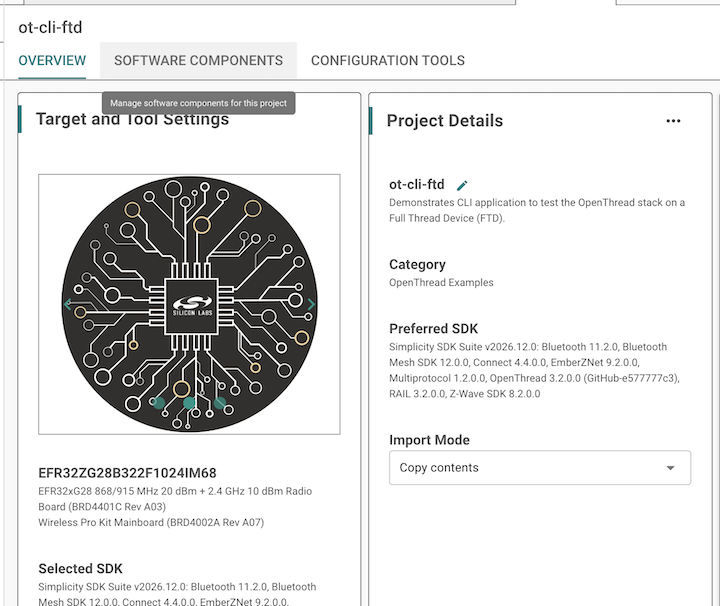
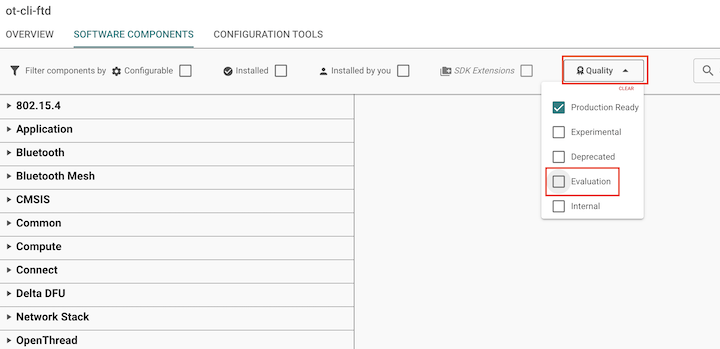
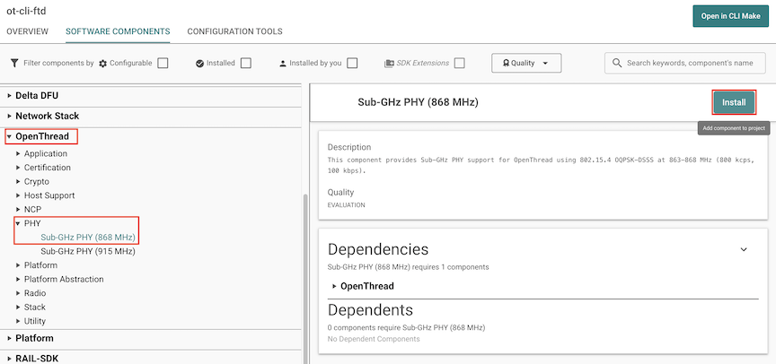

# Sub-GHz Support — Alpha Release

This alpha release extends OpenThread to 863-868 and 902-928 frequency bands, enabling evaluation of Thread in those frequencies.

The implementation included in SiSDK 26Q4 is an alpha release for evaluation only, and not intended for production use. Features, APIs, PHY parameters, and behavior are subject to change before general availability (GA). Compatibility with future releases is not guaranteed.

Supported chips are EFR32xG23 and EFR32xG28. The PHY is 802.15.4 OQPSK-DSSS at 800 kcps, spreading factor 8, 100 kbps, with a 1-byte PHR. The 868 MHz and 915 MHz bands are enabled by the components `ot_subghz_phy_868` and `ot_subghz_phy_915` respectively, and only one of them can be installed at a time. Installing either one turns on `RADIO_CONFIG_SUBGHZ_SUPPORT`. A 2.4 GHz build leaves it off.

## Key files

| File | Purpose |
|------|---------|
| `component/ot_subghz_phy_868.slcc` | 868 MHz component. Selects the 868 RAIL config, defines `RADIO_CONFIG_SUBGHZ_SUPPORT`, and requires `ot_duty_cycle_manager`. |
| `component/ot_subghz_phy_915.slcc` | 915 MHz component. Same radio role for 915. Conflicts with the 868 component. Does not install the duty-cycle component. |
| `component/ot_duty_cycle_manager.slcc` | TX duty-cycle accountant. Required by the 868 PHY. Optional on a 915 project. |
| `868MHZ_OQPSK_100KBPS_XG23.c` | Generated RAIL config, xG23, channels 1–4. |
| `868MHZ_OQPSK_100KBPS_XG28.c` | Generated RAIL config, xG28, channels 1–4. |
| `915MHZ_OQPSK_100KBPS_XG23.c` | Generated RAIL config, xG23, channels 5–25. |
| `915MHZ_OQPSK_100KBPS_XG28.c` | Generated RAIL config, xG28, channels 5–25. |
| `platform-abstraction/efr32/rail_config.h` | Picks the RAIL header for the installed band and part. |
| `platform-abstraction/efr32/radio_interface.h` | Sub-GHz bitrate, SHR and PHR sizes, ACK and turnaround times, PTI id. |
| `platform-abstraction/efr32/openthread-core-efr32-config.h` | Stack channel minimum, maximum, and mask for the installed band. |
| `platform-abstraction/efr32/radio.cpp` | When the duty-cycle component is present: starts and stops the accountant, gates transmit, records completed frames and outbound ACKs, default alert callback. |
| `platform-abstraction/include/radio_duty_cycle_manager.h` | Public duty-cycle API. The one-hour window is fixed here. |
| `platform-abstraction/efr32/duty-cycle-manager/radio_duty_cycle_manager.cpp` | Buckets, budget check, and alert bands. |
| `config/sl_openthread_subghz_config.h` | Studio options for the maximum duty percent and the bucket period. Installed with `ot_duty_cycle_manager`. |
| `src/cli/radio_subghz_cli.c` | `subghz` commands. `duty-cycle` is included when the duty-cycle component is present. |

The four `.c` files live in this directory, next to this note.

## Components

| Component | Role |
|-----------|------|
| `ot_subghz_phy_868` | 868 MHz PHY. Installing it also installs `ot_duty_cycle_manager`. |
| `ot_subghz_phy_915` | 915 MHz PHY. Does not install duty cycling. |
| `ot_duty_cycle_manager` | TX duty cycling over a rolling hour. |

Only one PHY component can be installed. `ot_duty_cycle_manager` can be installed with either PHY. The 868 PHY includes it by default since it is required in the EU 863-868 band. The 915 PHY does not include it since it is not required in the NA 902-928 band.

## PHY

| Component | Band | Channels | Center frequencies |
|-----------|------|----------|--------------------|
| `ot_subghz_phy_868` | 863–868 MHz | 1–4 | 863.7 MHz on channel 1, then +1.2 MHz, through 867.3 MHz on channel 4 |
| `ot_subghz_phy_915` | 902–928 MHz | 5–25 | 903.2 MHz on channel 5, then +1.2 MHz, through 927.2 MHz on channel 25 |

RAIL tunes with `base + spacing × (channel − physical_channel_offset)`. The 868 table uses offset 1. The 915 table uses offset 5.

Sub-GHz MAC timings in `radio_interface.h`:

| Constant | Value |
|----------|-------|
| ACK timeout | 2160 µs |
| RX to TX | 480 µs |
| TX to RX | 480 µs |
| `OPENTHREAD_CONFIG_MIN_RECEIVE_ON_AHEAD` | 480 µs (12 symbols at 40 µs/symbol) |
| PTI PHY id | `0x17` |

On-air time is `(SHR 5 + PHR 1 + PSDU) × 80` µs. `mLength` already includes the 2-byte FCS, so a 20-byte MAC command is 22 bytes and 2240 µs. An immediate ACK is 5 bytes and 880 µs.

## Duty cycle

The accountant is the `ot_duty_cycle_manager` component. The 868 PHY requires it. A 915 project leaves it out unless you add the component. `radio.cpp` calls it only when `SL_CATALOG_OT_DUTY_CYCLE_MANAGER_PRESENT` is set. `efr32RadioInit()` starts it and `efr32RadioDeinit()` stops it. Changing the PAN id does not restart the hour.

The bucket period is `SL_OT_RADIO_TX_TIME_BUCKET_SEC_DEFAULT` in `sl_openthread_subghz_config.h`, default 60 s. It has to divide the hour evenly. At the default, the ring is one slot per minute in the hour, plus a spare. A shorter bucket tracks the hour more closely, and it costs RAM and wakes the timer more often.

**Note:** The transmit limit is a percent of that hour. Set `SL_OT_DUTY_CYCLE_MAX_PERCENT_DEFAULT` in `sl_openthread_subghz_config.h`, which Studio installs with `ot_duty_cycle_manager`. The default is **2.8%** (100.8 s). The allowed range is 0.1 to 100.0, in steps of 0.1.

The alert bands are fractions of the configured budget: medium 50%, warning 75%, high 90%. At the default 2.8%, that budget is 100.8 s. A frame is turned away only when its estimate is larger than the time still left. Medium, warning, and high still let the frame go out.

A frame that goes on the air is added to the hour. That includes a frame that got no ACK, and an ACK this node sends. A frame the check turns away is not added. A rejected attempt does not give any time back either. The hour stays where it is until the bucket timer ticks. Each tick drops the oldest minute and starts a new one at zero. The next frame is allowed only when the time left is at least that frame's estimate. If the airtime that filled the hour is in the recent minutes, dropping an empty older minute changes nothing, and advertisements keep getting aborted until those recent minutes age out. That can take most of the hour. Stopping traffic does not clear the window.

## Alert callback

`efr32RadioInit()` registers `sli_ot_radio_duty_cycle_alert_callback`. The accountant calls it only when the band goes up (`LOW` toward `MEDIUM`, `WARNING`, `HIGH`, or `EXHAUSTED`). If the usage jumps over a band, you get one call for the band it landed on. A drop, including coming back out of exhausted, does not call it, so there is no alert log when the radio starts transmitting again.

The platform copy of this function is weak (`OT_TOOL_WEAK`). The application can rewrite this function and implement its own alert handling.

As the callback can run from the sleeptimer ISR, the platform version does not print anything. It copies the status and sets a pending flag, `sDutyCycleAlertPending`. `efr32RadioProcess()` collects the data and prints it. The same flag also wakes the platform task through `efr32RadioIsDataReady()`, so the print is not left waiting for the next radio event. The sample alert print follows this format.

```
!!!Duty cycle alert triggered!!!
Total TX time: <total_tx_us>
Current period TX time: <current_period_tx_us>
Max budget: <max_budget_us>
Remaining budget: <remaining_budget_us>
Duty permille: <duty_permille>
Max duty permille: <max_duty_permille>
Level: <NONE|LOW|MEDIUM|WARNING|HIGH|EXHAUSTED>
```

`Level` is the band after the step up. It does not decide whether the next frame is allowed. That still comes from the remaining budget.

## CLI

With the custom CLI component, the `subghz` command is available. `subghz duty-cycle` lists `get-stats` and `get-buckets` when `ot_duty_cycle_manager` is installed. An 868 build has it. A 915 build has it only if you add that component.

`get-stats` shows the budget, transmit time in the current minute, the hour total, what is left, permille, percent of the hour, and the alert level.

`get-buckets` shows the current index and every slot, including the spare. The spare is the slot the next tick clears. It is not part of the hour total yet.

## Quick test

### How to build

Create an OpenThread CLI Full Thread Device (FTD) project as described in the [Quick Start Guide](https://docs.silabs.com/openthread/3.1.2/openthread-getting-started-overview/).

Open the **SOFTWARE COMPONENTS** tab.



The Sub-GHz PHY components are evaluation quality. Open the **Quality** filter and select **Evaluation** so they are listed.



Under **OpenThread > PHY**, install one Sub-GHz PHY:

- **Sub-GHz PHY (868 MHz)** (`ot_subghz_phy_868`). Installing this component also installs `ot_duty_cycle_manager`.
- **Sub-GHz PHY (915 MHz)** (`ot_subghz_phy_915`). 

The two PHY components conflict. Install only one of them. The figure below shows the 868 MHz component selected for installation.




Build the project.

Note:
    Use a Silicon Labs development board equipped with an `xG23` or `xG28` radio for Sub-GHz operation. Suitable boards include the `xG23` `BRD4210A` or `BRD2600A`, and the `xG28` `BRD4400C` or `BRD4401C`. The `BRD4210A`, `BRD4400C`, and `BRD4401C` radio boards require a compatible Wireless Starter Kit mainboard.

### Bring-up

Leader on 868:

```
dataset init new
dataset channel 1
dataset commit active
ifconfig up
thread start
dataset active -x
```

Joiner:
```
dataset set active <leader-hex>
dataset commit active
ifconfig up
thread start
```

Note:
- On a 915 MHz image, use a channel from 5 through 25. 
- The joiner takes the leader dataset with `dataset set active <leader-hex>`, leader-hex is the output of `dataset active -x`

